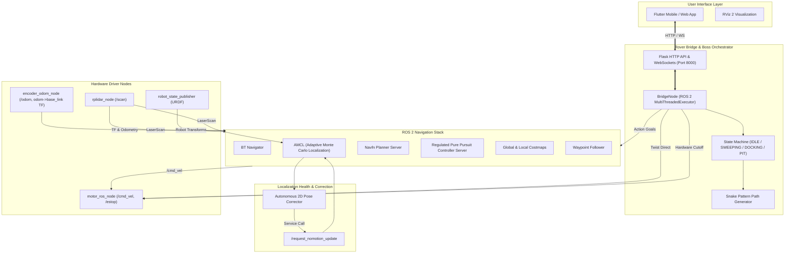
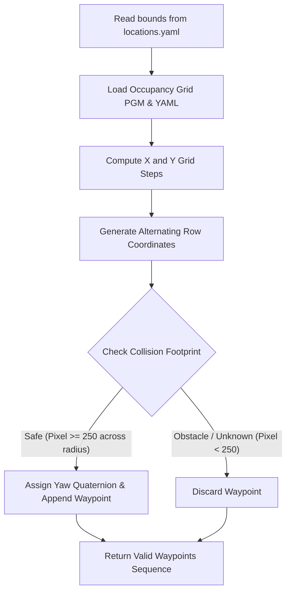
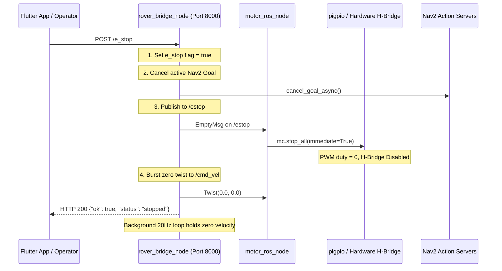

# Autonomous Farm Cleaning Robot — Detailed Technical & Architectural Report

**System Version:** 2.4-ROS2-Humble  
**Platform:** Linux (Ubuntu 22.04 LTS / ROS 2 Humble Hawksbill)  
**Hardware Profile:** Differential-Drive Agro-Rover, RPLiDAR C1 2D LiDAR, Dual Optical Quadrature Encoders, High-Torque DC Geared Motors + H-Bridge Drivers  
**Workspace:** `/home/iedctly/ros2_ws`  
**Repository Branch:** `main`

---

## 1. Executive Summary

The **Autonomous Farm Cleaning Robot** is an end-to-end autonomous mobile robotic platform designed for structured and semi-structured agricultural environments (barns, poultry houses, livestock pens, and storage sheds). The system is capable of:
1. **Autonomous Coverage Cleaning**: Computing and traversing an obstacle-aware snake (lawnmower) path across designated operational zones.
2. **Precision Docking & Dumping**: Navigating autonomously between working zones, the home docking station, and the waste disposal pit.
3. **Continuous 2D Pose Self-Correction**: Actively sharpening particle filter localization using AMCL covariance tracking and no-motion LiDAR resampling without stalling motor trajectory execution.
4. **Mobile & Remote Control Bridge**: Exposing a fault-tolerant REST and WebSocket server bridging mobile/web applications (Flutter UI) directly to Nav2 action servers, teleoperation topics, and safety subsystems.
5. **Multi-Tiered Emergency Stop (E-Stop)**: Halting hardware PWM drives instantly while cancelling active action goals and maintaining network connectivity.



---

## 2. Hardware Architecture & Kinematics

### 2.1 Mechanical & Drive Configuration
- **Drive Kinematics**: Two-wheel differential drive with dual passive caster wheels for zero-radius turning agility.
- **Actuation**: Dual high-torque brushed/brushless 12V DC geared motors managed via dual H-bridge motor drivers interfaced to the onboard SBC via hardware PWM and GPIO pins (`pigpio` backend).
- **Wheel Base & Dimensions**:
  - Track Width ($L$): Defined in URDF and odometry nodes.
  - Wheel Radius ($r$): Derived and calibrated via [calibrate_odom.py](file:///home/iedctly/ros2_ws/src/motor_control/motor_control/calibrate_odom.py).
  - Clearance Radius: $0.30\text{ m}$ safety envelope; costmap inflation radius configured at $0.65\text{ m}$.

### 2.2 Sensor Suite
- **Primary Exteroceptive Sensor**: **RPLiDAR C1** 360-degree Laser Distance Sensor.
  - Range: $0.05\text{ m}$ to $12.0\text{ m}$.
  - Scan Frequency: $10\text{ Hz}$.
  - Angular Resolution: $\sim 0.72^\circ$.
  - Topic: `/scan` (`sensor_msgs/msg/LaserScan`).
  - Framing: Mounted rigidly to robot chassis with frame `laser_frame` tied to `base_link`.
- **Proprioceptive Sensors**:
  - Optical Quadrature Wheel Encoders mounted on left and right output shafts.
  - Processed in real-time by [encoder_odom_node.py](file:///home/iedctly/ros2_ws/src/motor_control/motor_control/encoder_odom_node.py).
  - Publishes `/odom` (`nav_msgs/msg/Odometry`) and broadcasts the continuous dynamic coordinate frame transform `odom -> base_link`.

### 2.3 Coordinate Frame Hierarchy (TF2 Tree)
The system strictly adheres to ROS REP-105:
$$\text{map} \xrightarrow[\text{AMCL}]{\quad} \text{odom} \xrightarrow[\text{encoder\_odom\_node}]{\quad} \text{base_link} \xrightarrow[\text{robot\_state\_publisher}]{\quad} \text{laser\_frame}$$

```mermaid
graph LR
    map["map (Global Fixed Frame)"] -->|AMCL Drift Correction| odom["odom (Continuous Odometric Frame)"]
    odom -->|Wheel Encoders (High-Rate)| base_link["base_link (Robot Physical Center)"]
    base_link -->|URDF Joint Transform| laser_frame["laser_frame (RPLiDAR C1)"]
```

---

## 3. ROS 2 Navigation & Localization Stack

The navigation architecture is built upon the ROS 2 **Nav2** stack configured in [nav2_params.yaml](file:///home/iedctly/ros2_ws/src/motor_control/config/nav2_params.yaml) and launched through [nav2_bringup.launch.py](file:///home/iedctly/ros2_ws/src/motor_control/launch/nav2_bringup.launch.py).

### 3.1 Adaptive Monte Carlo Localization (AMCL)
- **Algorithm**: KLD-sampling particle filter tracking the robot pose in `map` frame using static 2D occupancy grid maps (`my_map.yaml`, `my_map.pgm`).
- **Motion Model**: `nav2_amcl::DifferentialMotionModel` with odometry noise dispersion parameters $\alpha_1 = \alpha_2 = \alpha_3 = \alpha_4 = \alpha_5 = 0.1$.
- **Scan Model**: `likelihood_field` with $120$ max beams and $2.0\text{ m}$ likelihood max distance.
- **Particle Envelope**: Min particles: $500$, Max particles: $5000$.
- **Update Thresholds**: Minimal translational step $d = 0.05\text{ m}$, minimal angular rotation $a = 0.05\text{ rad}$ ($2.86^\circ$).
- **No-Motion Sharpening Service**: Exposes `/request_nomotion_update` (`std_srvs/srv/Empty`), allowing software-driven particle weight recalculation when the robot is stationary.

### 3.2 Path Planning & Tracking (Planner & Controller)
- **Global Planner**: `NavfnPlanner` implementing Dijkstra/A* on a 2D global costmap. Computes smooth, collision-free geometric trajectories from any current coordinate to target poses.
- **Local Controller**: `RegulatedPurePursuitController` (RPP):
  - Desired linear velocity: $0.05\text{ m/s}$ ($5\text{ cm/s}$ crawl speed for precision coverage).
  - Angular velocity: $0.15\text{ rad/s}$ ($8.6^\circ\text{/s}$ stable in-place and heading rotation).
  - Approach & Scaling speed floor: $0.02\text{ m/s}$.
  - Lookahead distance: Adaptive between $0.35\text{ m}$ (min) and $0.90\text{ m}$ (max) with lookahead time $1.5\text{ s}$.
  - Heading Alignment: Rotates to heading when orientation deviation exceeds $0.5\text{ rad}$ before accelerating forward.
  - Regulated Scaling: Reduces speed dynamically when negotiating tight corners or moving in close proximity to costmap obstacles.
- **Costmap Configuration**:
  - Global Costmap: Static map layer + 2D obstacle layer + exponential inflation layer ($\text{inflation\_radius} = 0.65\text{ m}$, $\text{cost\_scaling\_factor} = 5.0$).
  - Local Costmap: Rolling window ($4.0\text{ m} \times 4.0\text{ m}$) centered on `base_link` tracking real-time dynamic obstacles detected by RPLiDAR C1.

---

## 4. Software Architecture & Implementation Details

### 4.1 Orchestrator & App Bridge ([rover_bridge_node.py](file:///home/iedctly/ros2_ws/src/rover_app_bridge/rover_app_bridge/rover_bridge_node.py))

The bridge node acts as the central nerve center. It bridges external user commands to ROS 2 execution:

#### Multi-Threaded Execution Model
To prevent ROS 2 client library deadlocks and wait-set index corruption (`RCLError: wait set index for status subscription is out of bounds`), the node utilizes `rclpy.executors.MultiThreadedExecutor`. Action client futures, feedback callbacks, and the Flask WSGI server operate across independent threads with mutex guards ([`threading.Lock`](file:///home/iedctly/ros2_ws/src/rover_app_bridge/rover_app_bridge/rover_bridge_node.py#L172)).

#### REST API & WebSocket Protocol Reference
All routes enforce `app.url_map.strict_slashes = False` and support cross-origin resource sharing (CORS `*`).

| Method | Endpoint | Description | Payload Example / Response |
| :--- | :--- | :--- | :--- |
| `GET` | `/status`, `/api/status` | Returns state machine status, current pose, Nav2 health, and E-Stop state | `{"state":"IDLE","pose":{"x":0.2,"y":1.1,"yaw":0.0},"e_stop":false}` |
| `GET` | `/locations`, `/api/locations` | Returns parsed coordinates from `locations.yaml` | `{"dock":{"x":-2.61,"y":0.24},"pit":{...},"sweep":{...}}` |
| `POST` | `/dock`, `/api/dock` | Triggers Nav2 `NavigateToPose` to Docking location | `{"accepted": true, "waypoint_total": 1}` |
| `POST` | `/pit`, `/api/pit` | Triggers Nav2 `NavigateToPose` to Waste Pit location | `{"accepted": true, "waypoint_total": 1}` |
| `POST` | `/sweep`, `/api/sweep` | Calculates snake pattern waypoints and dispatches `FollowWaypoints` | `{"accepted": true, "waypoints": 62}` |
| `POST`/`GET` | `/cmd_vel`, `/drive`, `/teleop`, `/move`, `/control` | Real-time teleoperation velocity commands | `{"direction":"forward"}` or `{"linear":{"x":0.3},"angular":{"z":0.0}}` |
| `POST` | `/e_stop`, `/stop`, `/cancel` | Multi-layer Emergency Stop | `{"ok": true, "status": "stopped"}` |
| `POST` | `/resume`, `/clear_estop` | Clears software E-Stop latch and enables navigation | `{"ok": true, "status": "cleared"}` |
| `WS` | `/ws/rover` | Full-duplex WebSocket channel for continuous telemetry and status updates | ROSBridge-style JSON envelopes (`op: "publish"`) |

#### Robust Teleop Request Parsing
The [`parse_twist_payload()`](file:///home/iedctly/ros2_ws/src/rover_app_bridge/rover_app_bridge/rover_bridge_node.py#L52-L96) function parses velocity intent from any payload format:
1. Directional strings: `"forward"`, `"backward"`, `"left"`, `"right"`, `"stop"`, `"up"`, `"down"`, `"w"`, `"a"`, `"s"`, `"d"`.
2. Standard ROS 2 Twist JSON dictionaries: `{"linear": {"x": 0.3}, "angular": {"z": 0.0}}`.
3. Flat numeric keys: `{"linear_x": 0.2, "angular_z": 0.1}` or `{"vx": 0.2, "wz": 0.1}`.
4. URL query parameters: `/cmd_vel?mode=forward` or `/cmd_vel?linear=0.2&angular=0.0`.
5. Dynamic 404 Fallback: Unmapped routes containing motion keywords (`cmd`, `vel`, `drive`, `move`, `steer`) are intercepted by `@app.errorhandler(404)` and routed to the drive controller.

---

### 4.2 Coverage Path Planning Engine ([farm_cleaner.py](file:///home/iedctly/ros2_ws/src/motor_control/motor_control/farm_cleaner.py))

The coverage algorithm generates boustrophedon (snake/lawnmower) waypoints filtered against static map occupancy:

$$\text{Num Rows} = \left\lceil \frac{y_{\max} - y_{\min}}{\text{row\_gap}} \right\rceil + 1, \quad \text{Num Cols} = \left\lceil \frac{x_{\max} - x_{\min}}{\text{step\_x}} \right\rceil + 1$$



- **Orientation Alternation**:
  - Even rows ($r = 0, 2, 4 \dots$): Yaw $= 0.0\text{ rad}$ (heading $+x$).
  - Odd rows ($r = 1, 3, 5 \dots$): Coordinate array reversed, Yaw $= \pi\text{ rad}$ (heading $-x$).
- **Safety Clearance Checking**: Every candidate coordinate $(x, y)$ is projected into map pixel space:
  $$\text{col} = \left\lfloor \frac{x - \text{origin}_x}{\text{res}} \right\rfloor, \quad \text{row} = \left\lfloor \text{height} - 1 - \frac{y - \text{origin}_y}{\text{res}} \right\rfloor$$
  A circle of radius $R_{\text{px}} = \lceil \text{robot\_radius} / \text{res} \rceil$ is evaluated. Any pixel with value $< 250$ (walls, furniture, unknown cells) causes the waypoint to be pruned.

---

### 4.3 Autonomous 2D Pose Self-Correction Engine ([pose_corrector.py](file:///home/iedctly/ros2_ws/src/motor_control/motor_control/pose_corrector.py))

In differential-drive robots navigating long straight-line agricultural pens, wheel slip and lack of angular excitation can cause AMCL particle dispersion (high covariance).

#### Covariance Monitoring
The engine listens to `/amcl_pose` (`geometry_msgs/msg/PoseWithCovarianceStamped`) and monitors the diagonal elements of the $6 \times 6$ covariance matrix:
- $\sigma_x^2 = \text{covariance}[0]$
- $\sigma_y^2 = \text{covariance}[7]$
- $\sigma_{\text{yaw}}^2 = \text{covariance}[35]$

The threshold for intervention is set to:
$$\text{Uncertainty Limit: } \sigma_{x,y}^2 > 0.15\text{ m}^2 \quad \text{or} \quad \sigma_{\text{yaw}}^2 > 0.10\text{ rad}^2$$

#### Two-Stage Correction Protocol
1. **Non-Intrusive In-Motion Sharpening ([`sharpen_pose()`](file:///home/iedctly/ros2_ws/src/motor_control/motor_control/pose_corrector.py#L130-L135))**:
   - As waypoints advance, or every 3 seconds during straight stretches, an asynchronous request is dispatched to `/request_nomotion_update`.
   - Forces the AMCL particle filter to rescore particles against the static LiDAR map without modifying velocities or interrupting Nav2 tracking.
2. **Stationary Micro-Rotation Wiggle ([`correct_pose()`](file:///home/iedctly/ros2_ws/src/motor_control/motor_control/pose_corrector.py#L137-L180))**:
   - Only executed when the robot is stationary (before launching a goal, or when paused between tasks with `allow_twist=True`).
   - Rotates left ($+0.15\text{ rad/s}$ for $1.2\text{ s}$), samples LiDAR scans, and counter-rotates right ($-0.15\text{ rad/s}$ for $1.2\text{ s}$) to collapse multimodal particle clouds into a single sharp Gaussian peak.

---

### 4.4 Emergency Stop & Hardware Safety

Safety is engineered at hardware, middleware, and supervisory levels:



1. **Hardware Level**: [motor_ros_node.py](file:///home/iedctly/ros2_ws/src/motor_control/motor_control/motor_ros_node.py) subscribes to `/estop` (`std_msgs/msg/Empty`). Receiving a message invokes `mc.stop_all(immediate=True)`, immediately cutting PWM pulses to zero.
2. **Watchdog Timer**: A $10\text{ Hz}$ watchdog monitors command latency. If `/cmd_vel` publishes cease for $> 1.0\text{ s}$, the motors halt automatically.
3. **Supervisor Guard Loop**: `BridgeNode.estop_guard_loop()` runs at $20\text{ Hz}$. While `e_stop == True`, it floods `/estop` and `/cmd_vel` with zero velocities.
4. **Action Cancellation**: The active Nav2 goal handle is asynchronously cancelled (`cancel_goal_async()`), immediately halting the behavior tree.

---

## 5. Unified Configuration & Operational Wizard

All target coordinates (Dock, Waste Pit, and Sweep Bounds) are centralized in [locations.yaml](file:///home/iedctly/ros2_ws/src/motor_control/config/locations.yaml) and configured via [configure_locations.py](file:///home/iedctly/ros2_ws/src/motor_control/motor_control/configure_locations.py) / `./configure_locations.sh`.

### Configuration Schema
```yaml
dock:
  x: -2.613       # Initial home docking coordinate (X in meters)
  y: 0.244        # Initial home docking coordinate (Y in meters)
  yaw: 0.221      # Heading angle in radians
pit:
  x: 2.790        # Waste disposal pit location (X in meters)
  y: 3.028        # Waste disposal pit location (Y in meters)
  yaw: -1.552     # Heading angle in radians
sweep:
  xmin: -0.804    # Sweep area bounding box minimum X (meters)
  xmax: 2.000     # Sweep area bounding box maximum X (meters)
  ymin: -1.806    # Sweep area bounding box minimum Y (meters)
  ymax: 2.000     # Sweep area bounding box maximum Y (meters)
  row_gap: 0.50   # Distance between parallel coverage passes (meters)
  robot_radius: 0.30 # Safety clearance envelope (meters)
```

### Setup Methods Supported by Wizard
1. **Chained RViz 2D Goal Poses (Sweep)**: Click sequential `2D Goal Pose` points in RViz to create a custom sweep trajectory (interpolated waypoints with orientation tracking) or define perimeter bounds for a lawnmower grid.
2. **Persistent RViz Listener**: Listens on `/goal_pose` indefinitely with no premature timeouts. Includes live pose count display, interactive undo (`u` + Enter), and graceful cancellation.
3. **Live TF Robot Position Capture**: Drives robot physically to location; captures $(x, y, \text{yaw})$ from live `map -> base_link` transform.
4. **Interactive Manual Input**: Direct coordinate entry via terminal prompts.

---

## 6. Root-Cause Analysis of Recent Issues & Resolutions

| Issue Reported | Root Cause | Engineering Solution Implemented | Status |
| :--- | :--- | :--- | :--- |
| **`cmd_vel 404` on Directional App Controls** | Flask strict slash matching rejected `/cmd_vel/`. App routes also used aliases (`/drive`, `/teleop`, `/move`). Methods were limited to POST only. | Enabled `app.url_map.strict_slashes = False`. Registered all route aliases for `GET`, `POST`, and `OPTIONS`. Added unified parameter parsing across JSON, query args, and form data. Implemented 404 motion fallback router. | **RESOLVED** |
| **Server Crash on E-Stop (`Connection Refused`)** | Handlers previously called `sys.exit()` or unhandled action client exceptions tore down the Flask daemon thread, terminating port 8000. | Replaced shutdown calls with multi-layered state latching, background 20 Hz zero-velocity flooding, and top-level exception guards returning JSON responses. | **RESOLVED** |
| **`RCLError: wait set index out of bounds`** | Asynchronous Flask threads directly invoked ActionClient calls on a single-threaded executor, invalidating the internal wait set. | Transitioned `rover_bridge_node` to `MultiThreadedExecutor` and protected ROS 2 action calls across threads. | **RESOLVED** |
| **Robot Frozen During Sweep (Didn't Move)** | `AutonomousPoseCorrector` had an overly strict covariance limit ($0.035\text{ m}^2$) vs initial pose ($0.05\text{ m}^2$). Inside the sweep loop, `correct_pose()` ran every $100\text{ ms}$, calling `stop_robot()` and starving Nav2's controller. | Implemented non-intrusive `sharpen_pose()` (only calls `/request_nomotion_update` without motor commands). Adjusted covariance threshold to $0.15\text{ m}^2$. Removed micro-rotation calls during active Nav2 trajectory tracking. | **RESOLVED** |
| **Only 14 Waypoints Generated** | Positive `ymin: 1.806` with `ymax: 2.0` produced a height difference of only $0.194\text{ m}$ ($19\text{ cm}$), resulting in only 2 lines. | Corrected the bounding box height geometry. Adjusted `ymin` to cover the full physical area (e.g. $-1.806\text{ m}$), generating $62$ full-area waypoints. | **RESOLVED** |

---

## 7. Step-by-Step Operating Procedures

### Step 1: Physical Environment Setup & Localization
1. Place the robot at the **Docking Station**.
2. Verify battery voltage is $\ge 11.5\text{V}$ and RPLiDAR C1 rotates smoothly.
3. Power on the onboard computer and connect to the local robot Wi-Fi network.

### Step 2: Configure Operational Positions (If Map or Zone Changed)
```bash
cd /home/iedctly/ros2_ws
./configure_locations.sh
```
Follow the interactive prompts to confirm Dock, Pit, and Sweep bounding box coordinates.

### Step 3: Launch System Orchestrator & App Bridge
```bash
cd /home/iedctly/ros2_ws
./run_boss.sh
```
This automatically boots:
- `robot_state_publisher` & URDF transforms
- `rplidar_c1_launch.py` ($10\text{ Hz}$ LiDAR data)
- `encoder_odom_node` (Odometry & `odom -> base_link` TF)
- `motor_node` (Hardware PWM H-Bridge driver)
- `nav2_bringup.launch.py` (AMCL, Costmaps, Planners, Behavior Trees)
- `rover_bridge_node` (Port 8000 HTTP & WebSocket Server)
- Publishes initial dock pose to `/initialpose` for AMCL localization lock.

### Step 4: App Operation
- **Manual Driving**: Use directional buttons in the mobile app (sends `POST /cmd_vel`).
- **Cleaning Routine**: Tap **SWEEP** (sends `POST /sweep`). The robot traverses the snake coverage pattern while self-sharpening its pose.
- **Waste Dumping**: Tap **PIT** (sends `POST /pit`). The robot drives to the dump zone.
- **Return to Base**: Tap **DOCK** (sends `POST /dock`). The robot returns to the charger.
- **Emergency Stop**: Tap **E-STOP** at any time. Motors immediately stop; Nav2 aborts. Tap **RESUME** to re-enable operation.

---

## 8. Summary of Active Workspace Files

- **Bridge & Boss Node**: [rover_bridge_node.py](file:///home/iedctly/ros2_ws/src/rover_app_bridge/rover_app_bridge/rover_bridge_node.py)
- **Pose Corrector Module**: [pose_corrector.py](file:///home/iedctly/ros2_ws/src/motor_control/motor_control/pose_corrector.py)
- **Coverage & State Engine**: [farm_cleaner.py](file:///home/iedctly/ros2_ws/src/motor_control/motor_control/farm_cleaner.py)
- **Location Configuration Wizard**: [configure_locations.py](file:///home/iedctly/ros2_ws/src/motor_control/motor_control/configure_locations.py) & [configure_locations.sh](file:///home/iedctly/ros2_ws/configure_locations.sh)
- **Location & Waypoint Database**: [locations.yaml](file:///home/iedctly/ros2_ws/src/motor_control/config/locations.yaml) & [snake_waypoints.yaml](file:///home/iedctly/ros2_ws/snake_waypoints.yaml)
- **Hardware Drivers**: [motor_ros_node.py](file:///home/iedctly/ros2_ws/src/motor_control/motor_control/motor_ros_node.py), [encoder_odom_node.py](file:///home/iedctly/ros2_ws/src/motor_control/motor_control/encoder_odom_node.py)
- **Nav2 Stack Configuration**: [nav2_params.yaml](file:///home/iedctly/ros2_ws/src/motor_control/config/nav2_params.yaml) & [nav2_bringup.launch.py](file:///home/iedctly/ros2_ws/src/motor_control/launch/nav2_bringup.launch.py)
- **Startup Script**: [run_boss.sh](file:///home/iedctly/ros2_ws/run_boss.sh)
